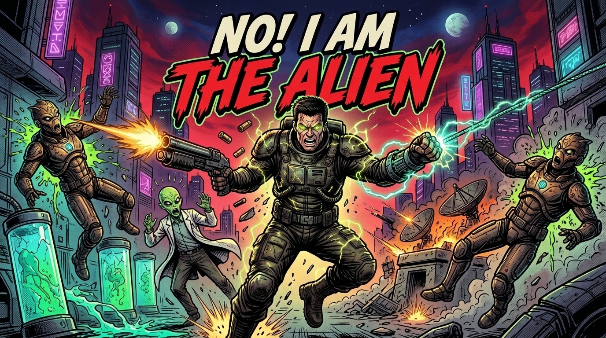
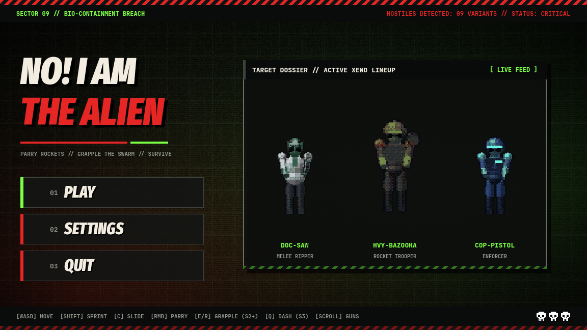
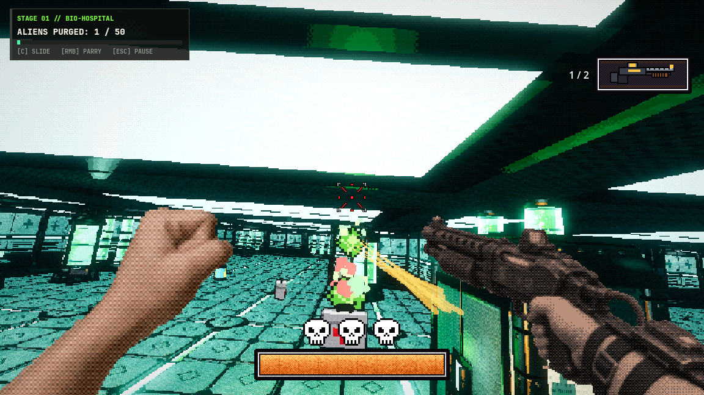
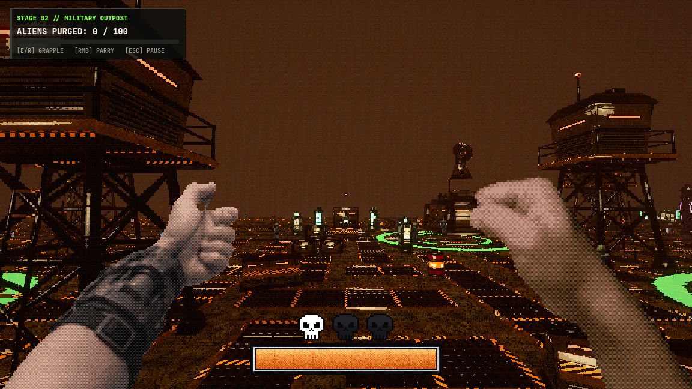
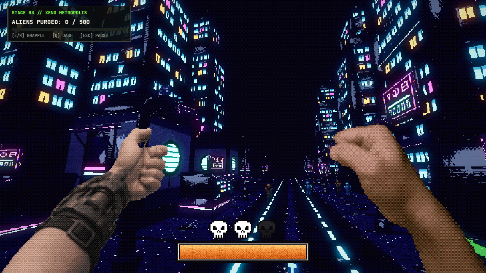

# NO! I am the alien

> **GitHub Game Off 2026 Entry — Theme: `SHIFT`**

**NO! I am the alien** is a fast-paced, brutalist PS2-era retro boomer shooter built with **Godot 4.7**. After crash-landing on a hostile alien world and breaking free from a bio-experimentation lab, you fight your way across three escalating, infinitely streaming procedural sectors.

To the aliens, **you** are the unstoppable invader.

---

## Theme Interpretation: `SHIFT`

- **Perspective Shift:** Classic sci-fi shooters put humanity on defense against invading aliens. Here the roles reverse — you crash-land on an alien world, mutate from bio-serum experiments, and become the terrifying "alien" tearing through their hospital, military outpost, and neon metropolis.
- **World & Ability Shift (Rebirth):** Purging each sector's alien quota unlocks a **Rebirth Shift**, warping you into a new infinite procedural biome while shifting your movement arsenal:
  - **Stage 01 — Bio-Hospital (50 Kills):** Close-quarters melee, slide-ramming, parrying, and scavenged guns inside an infinite bio-lab labyrinth.
  - **Stage 02 — Military Outpost (100 Kills):** Unlocks the **Grappling Hook** across open wasteland plains, bunkers, radar relays, and watchtowers.
  - **Stage 03 — Xeno Metropolis (500 Kills):** Unlocks the **`[Q]` Dash** for high-speed vertical combat across towering neon skyscrapers.
- **Combat & Visual Shift:** Deflect incoming rockets and bullets straight back at enemies with anime impact-frame parries, and shift visual styles live in `Settings → Video` (`PS2 Classic`, `Ultrakill Crisp`, `PS1 Crunch`, or `Off`).

---

## Screenshots

| Main Menu | Stage 01 — Bio-Hospital |
| :---: | :---: |
|  |  |

| Stage 02 — Military Outpost | Stage 03 — Xeno Metropolis |
| :---: | :---: |
|  |  |

---

## Controls

| Action | Default Binding |
| :--- | :--- |
| **Move** | `W A S D` / Arrow Keys |
| **Jump** | `Space` |
| **Sprint** | `Shift` |
| **Slide / Ram Enemies** | `C` |
| **Punch / Fire Weapon** | `Left Click` |
| **Cycle Right-Hand Weapon** | `Mouse Wheel` *(Fist / Pistol / Shotgun)* |
| **Parry Projectiles** | `Right Click` or `F` |
| **Toggle Grapple Hook** *(Stage 2+)* | `E` |
| **Fire Grapple** *(Stage 2+)* | Hold `R` |
| **Dash** *(Stage 3)* | `Q` |
| **Rebirth** *(when quota reached)* | `T` or step into the Rebirth Portal |
| **Pause / Settings** | `ESC` |

All controls, mouse sensitivity, FOV, audio mixers, and retro shader parameters can be customized in-game via `ESC → Settings`.

---

## Running from Source

1. Install **Godot 4.7+** (Forward+ / Vulkan renderer).
2. Clone this repository:
   ```bash
   git clone https://github.com/JustCyrr/no-i-am-the-alien.git
   ```
3. Open `project.godot` in Godot Editor and press **F5** to play.

---

## AI Usage Disclosure

Generative AI tools were used during development to assist with programming, 3D/2D visual assets, audio processing, UI copy, brainstorming, and testing.

---

## License

Released under the [MIT License](LICENSE).
